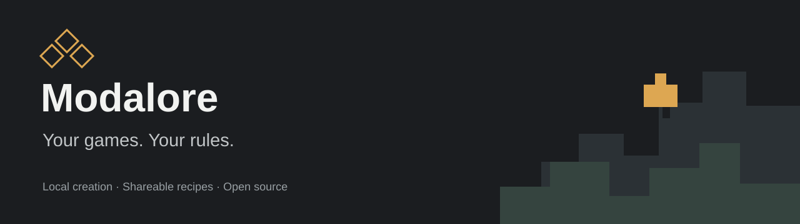
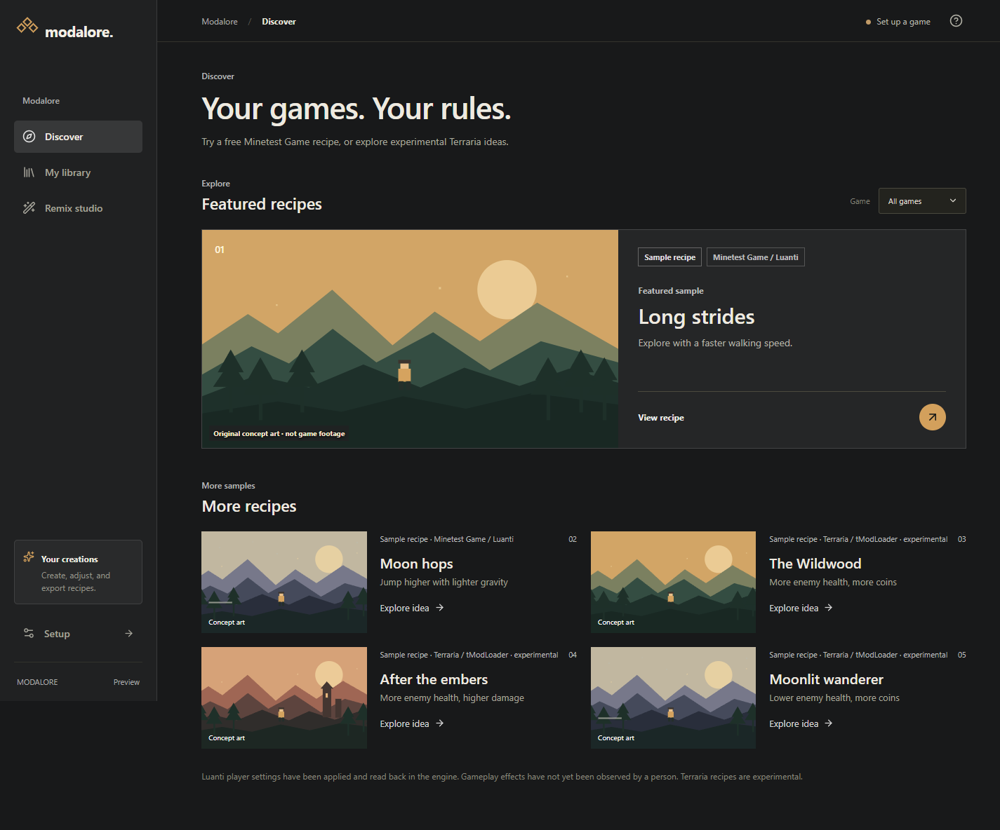

<p align="center"></p>

<p align="center">
  <a href="https://github.com/JeremySNR/Modalore/releases/download/v0.1.0-alpha.2/Modalore-0.1.0-alpha.2-Windows-x64-Setup.exe"><strong>Windows installer</strong></a> ·
  <a href="https://github.com/JeremySNR/Modalore/releases/download/v0.1.0-alpha.2/Modalore-0.1.0-alpha.2-Windows-x64-Portable.exe">Portable download</a> ·
  <a href="docs/GETTING_STARTED.md">Getting started</a> ·
  <a href="docs/VERIFICATION.md">What actually works</a> ·
  <a href="https://github.com/JeremySNR/Modalore/issues">Feedback</a>
</p>

[](https://github.com/JeremySNR/Modalore/actions/workflows/check.yml) [](LICENSE)

[0.1.0-alpha.2 release notes and checksums](https://github.com/JeremySNR/Modalore/releases/tag/v0.1.0-alpha.2). Unsigned Windows x64 preview.

**Modalore is a desktop app for changing the way a game plays.** Run faster, jump higher, or try lighter gravity. Start with a recipe, adjust a slider, or ask your own Codex CLI to make a change. Send the exact recipe to a friend.

**The free-game path uses Luanti + Minetest Game.** Modalore downloads a pinned, verified portable copy when you choose **Set up free game**, then gives each project its own world. Real Codex creation/revision, native game launch, connected-player settings, clean import and save recovery have passed local Windows checks. Visual movement inspection and clean-PC testing are still outstanding. Terraria recipes remain experimental. See [what was actually tested](docs/VERIFICATION.md).



### Try it

1. Open [Releases](https://github.com/JeremySNR/Modalore/releases) and choose the latest **Windows preview**.
2. Download the **Setup .exe** to install, or the **Portable .exe** to try without installing. Both are Windows x64. These preview downloads are **unsigned**, so Windows may show an unknown-publisher warning. Only use files from this repository and compare the supplied SHA-256 checksum if needed.
3. Open **Setup → Set up free game**. This downloads about 25 MB. No purchase, terminal or AI account is needed to play.
4. Open **Long strides → Play sample** to start a separate world. Move with **W A S D**, jump with **Space**, and use **Escape** to leave the game.
5. Choose **Make it mine**, adjust speed, jump or gravity, save, and play again. Close the game before changing its recipe. **Export this version** gives you a small file your friend can import.
6. For natural-language changes, open **Setup → Codex connection**. Modalore uses your separately installed Codex CLI and its supported sign-in. Creation uses your account’s applicable allowance.

Your first project starts a new Minetest Game world; existing saves are not imported. Archived projects can be brought back, and version history lets you restore earlier settings. [Read the full walkthrough](docs/GETTING_STARTED.md).

### What you can make

**Minetest Game:** change movement speed, jump impulse and gravity from 50% to 300%. Try “Give me higher jumps and lighter gravity.” Lower gravity lets you stay in the air longer. Minetest Game is a peaceful exploration, mining and building game; it has no built-in enemies or coin rewards.

**Terraria / tModLoader (experimental):** recipes change player damage, hostile enemy health and coin rewards. This separate adapter has not been built or played against an installed game. It requires your own Terraria installation.

Requests such as “Defeated enemies join my army” require mechanics that are **not implemented**. Codex is instructed to explain that boundary. Imported recipes contain data only; they cannot add executable code.

| Available in this preview                                            | Still to prove or build                                      |
| -------------------------------------------------------------------- | ------------------------------------------------------------ |
| Windows desktop UI, version history, reversible archive, concept art | Gameplay footage and broad novice user testing                |
| Real local Codex app-server connection, approvals, progress and stop | Broad stable-CLI compatibility and clean-machine onboarding  |
| Luanti setup, launch, player-settings readback and fresh-world import | Visual movement tests and broader game/version support       |
| Separate worlds and checkpoint restore after actual game writes    | Copying an existing save and clean-machine testing            |
| File sharing with parent-version attribution                         | Hosted publishing, live share pages, rankings or multiplayer |

There are no fake live share links, download counts, usage balances or gameplay recordings. A successful schema check is not a successful game test. Package hashes check integrity; they do not establish who made a file.

### Build from source

Use Windows x64, Node.js 24 LTS and Git. The UI also runs as a browser preview, with native actions clearly unavailable.

```powershell
git clone https://github.com/JeremySNR/Modalore.git
cd Modalore
npm ci
npm run dev
```

```powershell
npm run check          # Type checking, integration tests, production build
npm run test:ui        # Browser interactions and accessibility
node scripts/smoke-desktop.mjs  # Actual Electron bridge and startup measurement
npm run dist:win       # Windows installer and portable downloads in release/
```

`npm run dev:web` starts only the interface. It does not simulate successful native operations. Codex is started only when connecting or creating, not while browsing. No API key needs to be pasted into Modalore.

### Help shape it

The most useful contributions now are **real tModLoader testing**, Windows first-run feedback, and small, testable mechanics. Report what you tried, your versions, and what happened. Don’t attach saves, credentials or private Codex logs to a public issue.

Read [CONTRIBUTING](CONTRIBUTING.md), [ARCHITECTURE](ARCHITECTURE.md), the [research record](RESEARCH.md), and the [design research](docs/design-research.md). The source and original artwork are MIT-licensed. Terraria, tModLoader, Codex, and their trademarks belong to their respective owners; this project is independent and ships none of their game assets.
